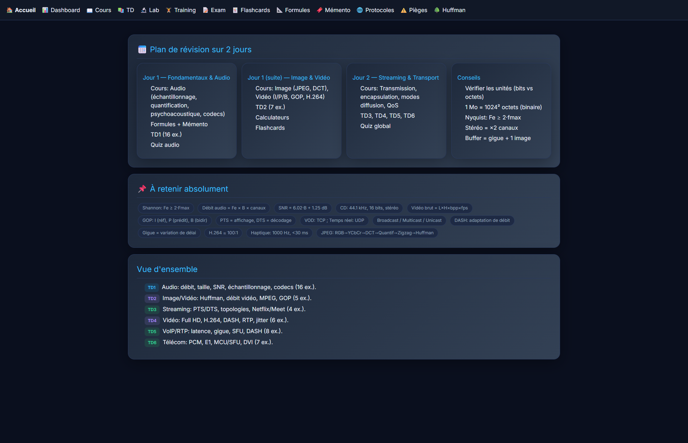

> 🤲 **الدعاء** — لِـ **Chekalil Aimene Charef Eddine**
>
> الدعاء: «اللهم صلِّ على نبينا محمد ﷺ»

# 🕌 Étude CMM — Communication Multimédia Master 2 IAA

**Interactive learning platform for the Communication Multimedia (CMM) — Master 2 IAA curriculum.**

Turn dense multimedia theory into bite-size practice: flashcards, quizzes, TD exercises, labs, formula sheets and exam prep — all in French, fully local-first and offline-capable.

## 🔗 Links

| Purpose | URL |
|---|---|
| 🚀 **Production** | <https://etude-cmm.vercel.app> |
| 👀 **Preview** | <https://cmm-ljif5tcai-ednodh.vercel.app> |
| 💻 **Source** | <https://github.com/aimenachraff-jpg/etude-cmm> |

## ✨ Features

- 🃏 **Flashcards** — spaced repetition with 3D flip (49 cards)
- 📝 **Quiz / QCM** — 30 gradable questions with explanations (score, timer, reset)
- 📚 **TDs** — 46 exercises across 6 Travaux Dirigés (TD1–TD6), solutions with toggles
- 📖 **Cours** — chapter content rendered from structured JSON
- 🔬 **Lab** — interactive calculators (bitrate, codec, Huffman, …)
- 🏋️ **Training** — exam training flow
- 📝 **Exam** — full exam page with timer and results
- 📐 **Formulas** — formula reference
- 🔖 **Mémento** — quick recall sheet
- 🌐 **Protocols** — transmission protocols
- ⚠️ **Pièges** — common traps/caveats
- 🌳 **Huffman** — live Huffman tree calculator (codes, entropy, average length, efficiency)

## 🛠 Tech Stack

- **Framework**: Next.js 15 (App Router) + React 18 + TypeScript
- **Styling**: Tailwind CSS 3 + CSS custom properties (dark theme)
- **State**: Zustand
- **Persistence**: Dexie (IndexedDB) — local-first
- **Math**: KaTeX
- **Icons**: lucide-react
- **Testing**: Vitest (unit) + Playwright (e2e)
- **Validation**: Zod, content lint/validate scripts
- **Deploy**: Vercel (preview + production)

## 📸 Screenshot

  

## 🚀 Deployment

- Deploy command: `npx vercel deploy --yes --scope ednodh --project cmm`
- Production deploy: `npx vercel deploy --prod --yes --scope ednodh --project cmm`
- Preview deployments are used for all current work; production is only deployed on explicit approval.

## 🤲 الدعاء

> لِـ **Chekalil Aimene Charef Eddine**
>
> الدعاء: «اللهم صلِّ على نبينا محمد ﷺ»

## 🙏 Thank you

Thanks to **Chekalil Aimene Charef Eddine** for the supplication, and thanks to everyone who contributes to learning.

---

*Built for the Master 2 IAA — Communication Multimedia curriculum.*
